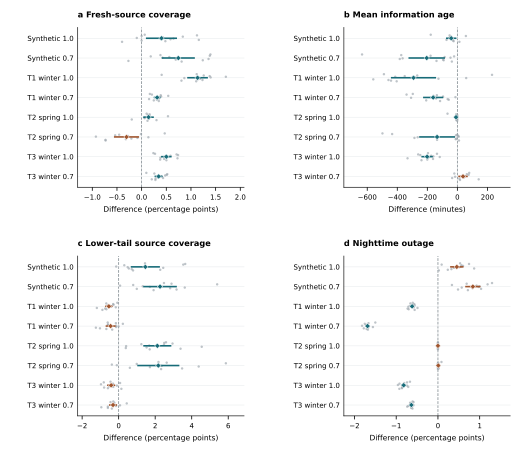
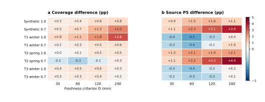

# Additional reproducibility figures

These paired displays accompany the current article. They use the same archived seed-level outcomes and are regenerated by the saved-result reproduction command.

## Figure R1. Seed-paired JLC-R effects in the independent confirmation.

[Download the vector PDF](../assets/paper_figures/fig3_confirmation.pdf).

All twelve seed differences in each of eight conditions, with paired means and nominal two-sided 95% t intervals. The comparator is the prefix-only control in Synthetic/T2 and PADC-AGE in T1/T3. Positive coverage/P5 and negative age/outage differences favor JLC-R. The vertical zero line indicates equal means, not the noninferiority margin. The 32 NI decisions use the specified one-sided Holm-36 procedure; interval overlap with zero does not determine those decisions. No seed or condition is excluded.

## Figure R2. Freshness-window sensitivity.

[Download the vector PDF](../assets/paper_figures/fig6_freshness.pdf).

Paired differences between JLC-R and its regime-matched comparator for (a) coverage and (b) Source P5 at 30, 60, 120 and 240 min. Positive values favor JLC-R. The 60-min column reproduces the study criterion; the other columns reuse the same delivered trajectories and imply no change in energy or sampling. Descriptive only.
